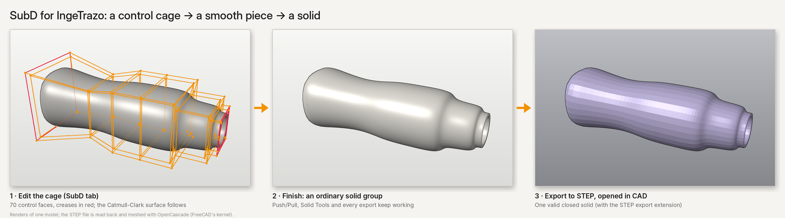

# SubD — subdivision modelling for IngeTrazo

▶ **Video tutorial:** [SubD tool for IngeTrazo((https://youtube.com/shorts/uhIoH_zuSDM?si=kr7fDxFeQO5eZX5q))

Model smooth, organic shapes (lamps, chairs, tables, furniture) from a coarse
control **cage**: push, pinch, crease and divide a few faces and the
Catmull-Clark surface follows. When you are happy, **Finish** turns it into an
ordinary group (a Solid Group if the cage is closed), so Push/Pull, Solid
Tools and the exports keep working.

An IngeTrazo extension: a `SubD` tab in the side tray with fourteen tools
(Create, Edit cage, Crease, Grow F, Grow E, Stretch, Offset F, Offset E,
Squeeze, Divide, Delete F, Close, Bridge, Shell), symmetry, join/bridge of two
pieces, conversion of existing groups to SubD, and a detail level for the
finished piece that keeps it light. Every step is one undo step; the cage is
saved inside the `.igz` (`group.ext["subdiv"]`) with no format change.

Full guide: [`docs/subdivision.md`](docs/subdivision.md).

## Install

Needs IngeTrazo 0.5.7 or newer.

- **From the catalog** (once listed): ingetrazo.com/extensiones.
- **By hand:** copy the `subdiv` folder into your plugins folder
  (*Extensions ▸ Open plugins folder*) and restart IngeTrazo. With the zip
  (`dist/subdiv-<version>.zip`), extract it so that the file
  `plugins\subdiv\__init__.py` exists — not `plugins\subdiv-1.0\subdiv\…`,
  which IngeTrazo does not load.

## Develop

The geometry and the tool logic (`subdivide`, `edit`, `follow`, `group`,
`ops`) are pure Python and are tested without Qt or IngeTrazo:

    pip install pytest
    pytest

(`tests/test_icons_subd.py` needs PySide6.) The interface is `subdiv/panel.py`;
the icons are drawn in `subdiv/icons.py`, so the extension needs nothing from
`views/icons.py`.

`python tools/build_zip.py` builds `dist/subdiv-<version>.zip` and prints its
SHA-256, which the catalog entry (`catalog/subdiv.toml`) needs. The archive is
deterministic: the same sources always give the same hash.

## Licence

GPL-3.0-or-later, like IngeTrazo. Written from scratch as a personal project
(no code from other software).
